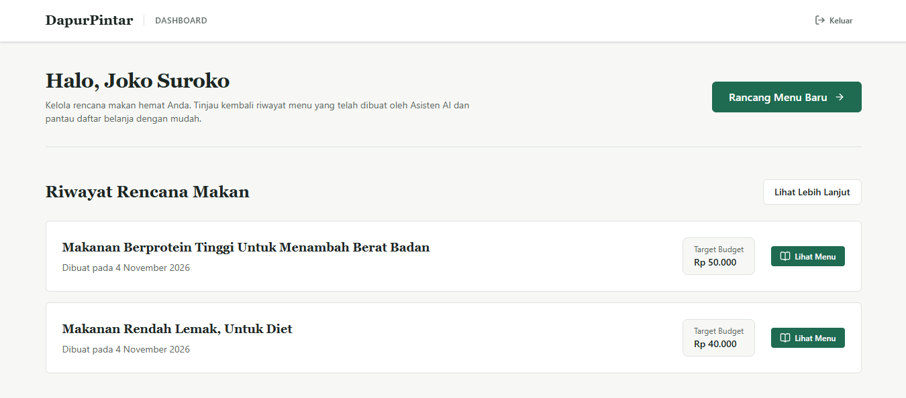
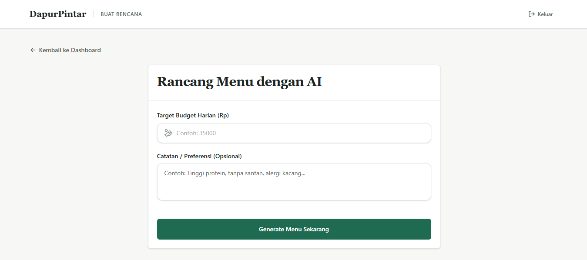
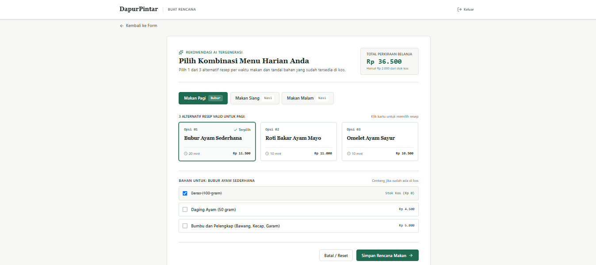
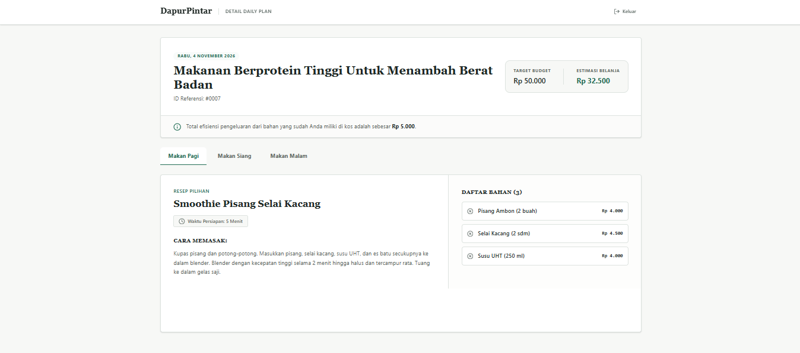

# 🍳 DapurPintar AI - Frontend Web App

Aplikasi _Single Page Application_ (SPA) interaktif untuk platform DapurPintar AI. Frontend ini dirancang dengan fokus pada _User Experience_ (UX) yang mulus, sinkronisasi data yang reaktif, dan antarmuka _Cozy Minimalist_ (Japandi Style) untuk membantu mahasiswa dan anak kos mengelola rencana makan hemat berbasis _Artificial Intelligence_.

Dibangun dengan arsitektur modern yang memisahkan secara tegas antara **Server State** (sinkronisasi API via TanStack Query) dan **Client State** (UI/interaksi pengguna via React Context) untuk menghasilkan performa yang cepat, cegah _over-fetching_, dan kode yang sangat _maintainable_.

---

## 🚀 Teknologi yang Digunakan

**Core & State Management:**

- **React (Vite):** Framework UI utama dengan _build tool_ Vite untuk _Hot Module Replacement_ (HMR) yang super cepat.
- **TanStack Query (React Query):** Digunakan sebagai _Server State Management_ untuk _data fetching_, _caching_, sinkronisasi, dan optimasi _request_ ke _backend_ (mengatasi _race conditions_ dan _loading states_).
- **React Router DOM:** Manajemen rute SPA (_Client-side routing_) dengan transisi halaman yang instan tanpa _reload_.
- **React Context API:** Digunakan secara terisolasi sebagai _Client State Management_ murni untuk mengelola sesi autentikasi pengguna secara global.

**Styling & UI Components:**

- **Tailwind CSS:** _Utility-first CSS framework_ untuk _styling_ yang responsif, konsisten, dan mudah dikustomisasi sesuai _design system_ aplikasi.
- **Lucide React:** Koleksi ikon SVG modern, ringan, dan konsisten.
- **React Hot Toast:** Sistem notifikasi (_toast_) interaktif untuk memberikan _feedback_ visual instan atas setiap aksi (sukses/error API).

**Integration & Networking:**

- **Axios:** HTTP Client yang dikonfigurasi secara ketat dengan `withCredentials: true` untuk menangani _cookie-based authentication_ (Sanctum) secara transparan.

---

## ✨ Fitur Utama (Key Features)

- **Intelligent Meal Generator UI:** Antarmuka form _step-by-step_ (_Wizard Pattern_) yang memandu pengguna memasukkan target _budget_ dan preferensi, sebelum men-_trigger_ Gemini AI.
- **Interactive Plan Selection:** Sistem seleksi (_Finite State Machine_ / FSM) yang memungkinkan pengguna memilih 1 dari 3 opsi resep per sesi (Pagi, Siang, Malam) secara dinamis tanpa berpindah halaman.
- **Ingredient Stock Tracking:** Fitur interaktif (centang bahan) yang mengalkulasi penghematan biaya secara _real-time_ berdasarkan bahan makanan yang sudah dimiliki pengguna di kos.
- **Optimized History Pagination:** Daftar riwayat rencana makan yang menerapkan teknik `keepPreviousData` dari TanStack Query. Menjamin transisi perpindahan halaman (_pagination_) bebas dari _flickering_ atau _blank screen_.
- **Comprehensive Plan Detail:** Halaman _read-only_ berdesain _tabbed navigation_ untuk membaca detail instruksi masak, daftar belanja, dan ringkasan finansial (_Target Budget_ vs _Estimasi Riil_) dengan _User Interface_ yang rapi.
- **Robust Error Handling:** Menerapkan pola _Early Return_ dan _Defensive Programming_ (Optional Chaining) untuk mencegah aplikasi _crash_ (_white screen of death_) saat API gagal, lambat, atau memberikan struktur JSON yang tidak terduga. Dilengkapi komponen `EmptyState` dan `ErrorState` yang _reusable_.

---

## 📸 Tangkapan Layar (Screenshots)

|              Halaman Utama (Dashboard)               |             Halaman Generate Menu AI              |
| :--------------------------------------------------: | :-----------------------------------------------: |
|   |  |
|             **Halaman Pemilihan Resep**              |            **Halaman Detail Riwayat**             |
|  |  |

---

## 🛠️ Cara Instalasi & Menjalankan (Lokal)

### 1. Kloning Repositori

```bash
git clone [https://github.com/RainerAdityatama/frontend-DapurPintar.git](https://github.com/RainerAdityatama/frontend-DapurPintar.git)
cd dapurpintar-frontend
```

### 2. Instalasi Dependensi

```bash
npm install
```

### 3. Konfigurasi Environment Variables

Buat file .env di root directory proyek dan sesuaikan konfigurasi URL dengan backend Laravel Anda:

```bash
# URL REST API Backend (Laravel) - Pastikan mengarah ke root domain backend
VITE_API_URL=http://localhost:8000
```

### 4. Menjalankan Development Server

```bash
npm run dev
```

Buka http://localhost:5173 di browser Anda.Penting: Pastikan Backend API (Laravel) juga sedang berjalan di localhost:8000 (atau sesuai konfigurasi .env) agar data dan fitur autentikasi (Cookie) dapat berfungsi.
